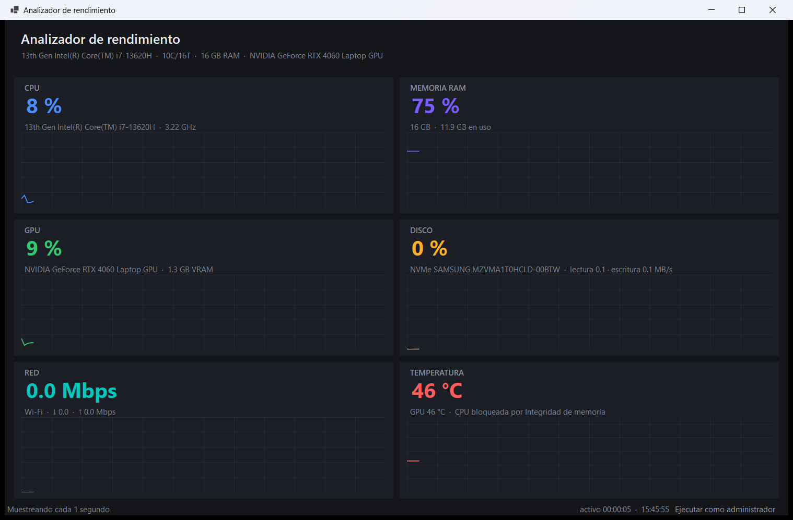
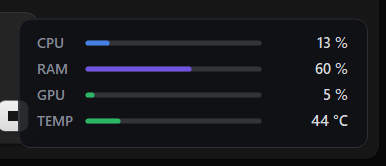

# Analizador de rendimiento

Monitor de rendimiento de PC en tiempo real para Windows, escrito en **C# / .NET 10 / Windows Forms**.

> Para retomar el proyecto en otra conversación, lee `CONTEXT.md` (resumen técnico compacto).

Muestra CPU, RAM, GPU, disco, red y temperaturas con histórico de los últimos 2 minutos,
sin dependencias pesadas y sin necesidad de administrador (salvo para las temperaturas).



---

## Requisitos

- Windows 10 (build 19041) o Windows 11
- .NET 10 SDK
- Visual Studio 2026 (o 2022 17.10+, que ya soporta `.slnx`)

## Compilar y ejecutar

```powershell
dotnet run --project PcAnalyzer.App
```

O abre `PcAnalyzer.slnx` en Visual Studio y pulsa F5.

`dotnet run` es solo un atajo de desarrollo: compila si hace falta, lanza la app **una vez**
y termina cuando la cierras. No la reinicia ni se queda en bucle (eso sería `dotnet watch`).
En Visual Studio, F5 ejecuta directamente el `.exe` de `bin\Debug\...`, no `dotnet run`.

## Modo compacto (overlay para jugar)

El botón **Modo compacto** de la barra de estado (o el atajo global `Ctrl+Alt+O`)
convierte la app en una ventana flotante de 280×104 que se queda en la esquina
inferior derecha de la pantalla, siempre visible y semitransparente:



- Muestra solo CPU, RAM, GPU y temperatura, con una barra y el valor de cada una.
- La barra de temperatura cambia de color: verde hasta 60 °C, ámbar hasta 80 °C, rojo por encima.
- **No roba el foco**: pulsarla no saca al juego del primer plano.
- Se arrastra con el ratón y al soltar se pega a la esquina más cercana.
- Doble clic → vuelve al panel completo. Clic derecho → opacidad (95/88/70/55 %), abrir panel o cerrar.
- El atajo global funciona con el juego en primer plano. Como `Ctrl+Alt+M` suele estar
  cogido por otras utilidades, la app prueba varias combinaciones en orden y muestra en la
  barra de estado la que realmente consiguió registrar.

El panel grande se **minimiza** (no se oculta) al entrar en modo compacto, así que siempre
puedes volver con Alt+Tab aunque el overlay se quede debajo de un juego.

## Distribuir

El `.exe` real ya existe en `bin\Debug\net10.0-windows10.0.19041.0\win-x64\PcAnalyzer.exe`.
Para una versión de Release hay dos formas:

```powershell
# Ligera: ~49 MB, requiere el .NET 10 Desktop Runtime instalado en el equipo destino
dotnet publish PcAnalyzer.App -c Release -r win-x64 --self-contained false `
  -p:PublishSingleFile=true -o publish\exe-ligero

# Portable: un único .exe de ~160 MB, no requiere instalar nada
dotnet publish PcAnalyzer.App -c Release -r win-x64 --self-contained true `
  -p:PublishSingleFile=true -p:IncludeNativeLibrariesForSelfExtract=true -o publish\exe-portable
```

Desde Visual Studio: clic derecho en `PcAnalyzer.App` → **Publicar**.

`IncludeNativeLibrariesForSelfExtract` no es opcional en la versión portable: SkiaSharp y el
driver de LibreHardwareMonitor son binarios nativos y, sin ese flag, el `.exe` arranca pero
falla al dibujar la primera gráfica.

## Estructura

```
PcAnalyzer.slnx
├─ PcAnalyzer.Core/                 Lógica, sin dependencias de UI (testeable)
│  ├─ Models/Sample.cs              Una "foto" del sistema en un instante
│  ├─ Models/HardwareInfo.cs        Datos fijos del equipo
│  ├─ HardwareInfoProvider.cs       Lectura única por WMI
│  ├─ PerformanceMonitor.cs         Bucle de muestreo en hilo de fondo
│  ├─ MemoryIntegrity.cs            Detecta si HVCI bloquea las temperaturas de CPU
│  ├─ Native/NativeMethods.cs       GetSystemTimes, GlobalMemoryStatusEx, CallNtPowerInformation
│  ├─ Native/Pdh.cs                 Envoltorio de PDH (contadores nativos)
│  └─ Samplers/                     Un archivo por métrica
└─ PcAnalyzer.App/                  WinForms: solo pinta
   ├─ MainForm.cs                   Orquesta y actualiza las tarjetas
   ├─ MainForm.Designer.cs          Chrome de la ventana (editable en el diseñador)
   ├─ OverlayForm.cs                Ventana flotante del modo compacto
   ├─ Native/HotKey.cs              Atajo global (RegisterHotKey)
   └─ Controls/MetricCard.cs        Tarjeta reutilizable con sparkline
```

La regla del proyecto: **Core no conoce WinForms**. Eso permite testear los samplers
sin abrir ventanas y cambiar la interfaz (a WPF, por ejemplo) sin tocar la lógica.

## De dónde sale cada dato

| Métrica | Fuente | Coste |
|---|---|---|
| CPU % | `GetSystemTimes` (diferencia de tiempos kernel/user/idle) | ~0 ms |
| Frecuencia CPU | PDH `Processor Frequency` × `% Processor Performance` | ~0 ms |
| RAM | `GlobalMemoryStatusEx` | ~0 ms |
| Disco | PDH `\PhysicalDisk(_Total)\...` (respaldo: WMI) | ~0 ms |
| Red | `NetworkInterface.GetIPStatistics` (diferencia de bytes) | ~1 ms |
| GPU % y VRAM | PDH `\GPU Engine(*engtype_3D)\...` (respaldo: WMI) | ~1 ms |
| Temperaturas | LibreHardwareMonitor (requiere administrador) | ~5 ms |
| Modelo de CPU/GPU/placa | WMI, una sola vez al arrancar | 200-500 ms |

Muestrear todo cuesta unos **5 ms cada segundo**, así que el propio monitor no distorsiona
lo que mide. (La primera versión usaba WMI para disco y GPU: 700 ms por muestra, es decir,
el 70 % de un núcleo ocupado en medir. De ahí el cambio a PDH.)

## Decisiones que conviene conocer

**PDH en vez de `PerformanceCounter`.** Los nombres de categorías y contadores de
`PerformanceCounter` están traducidos al idioma de Windows: `"Processor"` es `"Procesador"`
en español. Una app con esos nombres hardcodeados funciona en tu PC y falla en la del
cliente. `PdhAddEnglishCounter` acepta siempre el nombre en inglés y PDH lo traduce.

**WMI para los datos de hardware.** Las clases WMI (`Win32_Processor`, etc.) no están
traducidas nunca. Son lentas, así que se consultan una sola vez.

**`TargetFramework` = `net10.0-windows10.0.19041.0`.** No es un capricho: ScottPlot depende
de SkiaSharp, que publica binarios para `net8.0-windows10.0.19041`. Si usas el
`net10.0-windows` por defecto (que equivale a `windows7.0`), NuGet no encuentra esos
binarios, cae a los de .NET Framework y la app compila pero falla al arrancar.

**`PlatformTarget` = x64.** LibreHardwareMonitor carga binarios nativos y no admite 32 bits.

**Manifiesto `asInvoker`.** Pedir UAC siempre es molesto. La app arranca normal y el botón
"Ejecutar como administrador" del status bar relanza el proceso elevado cuando el usuario
quiere ver temperaturas.

## Limitaciones conocidas

- Las **temperaturas de CPU** necesitan leer los MSR del procesador, y eso exige cargar un
  driver de kernel. Hay dos bloqueos posibles, y la app distingue ambos en la tarjeta:
  1. **Integridad de memoria (HVCI)** activa: Windows rechaza el driver de
     LibreHardwareMonitor aunque ejecutes como administrador. Es el caso más habitual en
     Windows 11 de fábrica. Solo se resuelve desactivando esa opción en Seguridad de
     Windows → Seguridad del dispositivo → Aislamiento del núcleo (requiere reinicio), a
     cambio de perder esa protección.
  2. **Sin permisos**: si HVCI está desactivada, basta con el botón "Ejecutar como
     administrador".

  Las de **GPU** no dependen de nada de eso: NVIDIA/AMD las exponen por NVML/ADL y
  funcionan siempre. Si no hay ningún dato, la tarjeta muestra `n/d` en lugar de romperse.
- El **uso de GPU** depende de los contadores `GPU Engine` de Windows 10/11. En GPUs muy
  antiguas o en máquinas virtuales puede no haber datos.
- La **red** suma todas las interfaces activas, incluidas VPN y adaptadores virtuales.
  El tráfico puenteado puede contarse dos veces.
- `"% Disk Time"` puede pasar de 100 % en sistemas con varios discos; se recorta a 100.
- El **modo compacto** no aparece sobre juegos en **pantalla completa exclusiva** (Direct3D
  exclusivo): Windows no dibuja ninguna ventana encima en ese modo. Con "pantalla completa
  sin bordes" (lo habitual hoy) funciona. Si no lo ves, cambia ese ajuste en el juego.

## Siguientes pasos sugeridos

1. **Vista de procesos**: top 10 por CPU/RAM con `Process.GetProcesses()`.
2. **Alertas**: avisar cuando la CPU pase de X % durante N segundos.
3. **Persistencia**: guardar el histórico en SQLite y dibujar sesiones pasadas.
4. **Exportar**: CSV de la sesión para analizar en Excel.
5. **Tema claro**: los colores están centralizados en `MainForm` y `MetricCard`.
6. **Benchmark**: añadir un test de carga con puntuación (CPU multi-hilo, disco secuencial).
